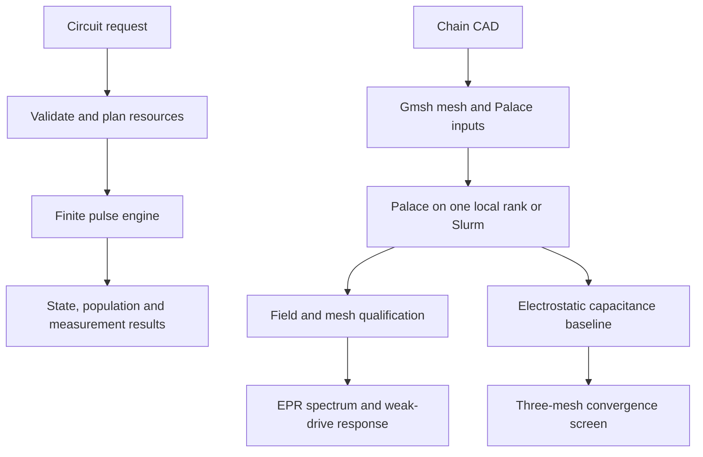

# EmulateQPU-4Q

EmulateQPU-4Q models a chain of four data transmons and three tunable couplers.
The chip CAD has four microwave drives and four readout resonators. Choose
one shared feedline or four dedicated feedlines on the same qubit layout. Run
an assumed finite-circuit experiment locally, generate 3D Gmsh meshes and
Palace inputs, or use solved fields to qualify a small-signal model.

The circuit example has editable parameters and runs without Palace. The
electrodynamic workflow requires a compatible Palace build for field solves
and applies mesh, mode, loss, and scattering checks before serving a reduced
model. The reduced response uses fixed idle biases and weak tones.

The present release candidate supports simulation studies under stated circuit
and readout assumptions. RF port convergence and the four readout linewidths
remain unqualified for the mounted device. A hardware digital twin requires
device-calibrated control and readout and held-out reset, gate, and mid-circuit
measurement results. [Qualification protocol](docs/FULLWAVE.md#qualify-predictions-for-the-mounted-assembly)

## Run a circuit experiment

From a source checkout, use Python 3.11 or later and install dependencies from
the lockfile. Use a fresh output directory for each run.

```sh
uv sync --locked
uv run --locked emulateqpu init --example four-qubit --output experiment
uv run --locked emulateqpu plan experiment/request.json
uv run --locked emulateqpu run experiment/request.json --output run
uv run --locked emulateqpu inspect run
```

Edit `experiment/request.json` to change the pulse amplitude, carrier frequency,
phase, or initial input. The example uses an assumed capacitance model and a
joint ideal measurement of all four data qubits. It runs on the CPU.

Run the four-channel pulse-to-IQ benchmark with `uv run --locked python -m emulateqpu.pulse_to_iq /scratch/qpu4/pulse-to-iq`. It checks seeded IQ replay, normalized classified probabilities, and the response to a q0 pulse versus matched idle. The example uses an assumed circuit and independent receiver bands.

## Generate the two chip layouts

```sh
uv sync --locked --extra physical
work=$(mktemp -d /tmp/emulateqpu4q.XXXXXX)
for topology in dedicated shared; do
  uv run --locked --extra physical python -m emulateqpu.fullwave layout \
    "$work/$topology-layout" --readout-topology "$topology"
  for refinement in coarse fine; do
    uv run --locked --extra physical python -m emulateqpu.fullwave prepare \
      "$work/$topology-$refinement" --readout-topology "$topology" --refinement "$refinement"
  done
done
```

The layout command exports GDSII. The prepare command generates the Gmsh mesh
and Palace inputs. The field guide covers setup for a matched crosstalk
comparison. The hardware references summarize published IBM and AWS readout
measurements. [Four-qubit field workflow](docs/FULLWAVE.md) ·
[Layout controls and isolation comparison](docs/FULLWAVE.md#adjust-the-layout-and-compare-isolation) ·
[Hardware references](docs/HARDWARE_REFERENCES.md) ·
[Mounted assembly and hardware qualification](docs/FULLWAVE.md#qualify-predictions-for-the-mounted-assembly) ·
[Slurm field jobs and circuit arrays](docs/HPC.md)

Use `layout --hardware` for the layered reference die with Josephson
junctions, SQUID flux lines, Purcell filters, ground bridges, and wire-bond
launches. Use `prepare-assembly` for the field inputs on the mounted die
with the carrier and wire bonds. Add `--flux-transfer` to prepare static
SQUID flux extraction. [Reference hardware layout](docs/REFERENCE_HARDWARE.md)

## Measure electrostatic mesh convergence

```sh
uv run --locked --extra physical python -m emulateqpu.fullwave.mesh_study prepare mesh-ladder --full-assembly
```

This creates three meshes with identical geometry and terminal order. Use
`mesh_study run` to solve each level with Palace and `mesh_study analyze` to
compare terminal capacitances and differential charging energies. The published
local diagnostic uses the original one-readout layout and includes the matrices
and run conditions from that design.
[Mesh qualification](docs/MESH_QUALIFICATION.md) ·
[Local mesh results](reproducibility/mesh-ladder/README.md)

Recalculate the published mesh differences from the saved capacitance tables.

```sh
uv run --locked --extra physical python reproducibility/mesh-ladder/replay.py
```

## Architecture



## Tests and licenses

Run `just test` for the core and field workflow tests. Run `just reference` for
independent scqubits spectra and QuTiP dynamics comparisons. The scheduler unit
tests use deterministic command fixtures. A separate single-node Slurm pilot
exercised circuit arrays and interrupt recovery. [Live scheduler evidence and site acceptance](docs/HPC.md#circuit-study-arrays)

Software is licensed under Apache-2.0. Original documentation and numerical
benchmark data are licensed under CC BY 4.0. [License](LICENSE.md) · [Notice](NOTICE) ·
[Dependency licenses](THIRD_PARTY.md) · [Contributing](CONTRIBUTING.md)
