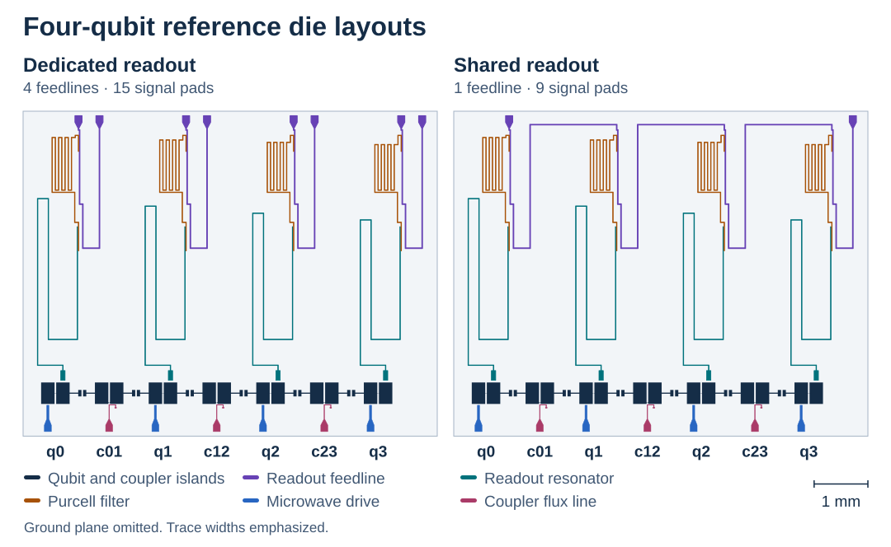
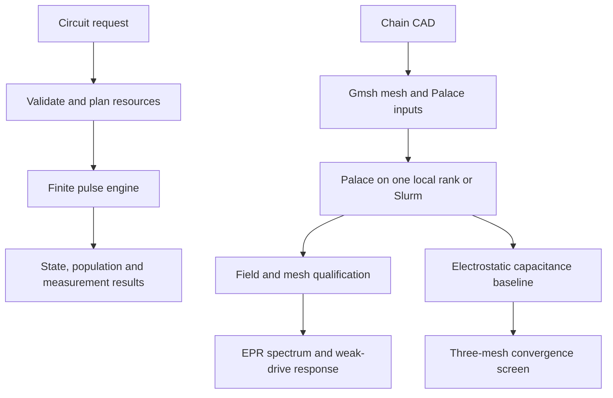

# EmulateQPU-4Q

[](https://github.com/syedshubha/EmulateQPU-4Q/actions/workflows/ci.yml)

EmulateQPU-4Q simulates microwave control and readout for a superconducting chip
with four transmons and three tunable couplers. Run pulse experiments on a CPU,
export layouts as GDSII, or generate Gmsh meshes and Palace solver inputs for
electromagnetic studies.



The two CAD layouts use the same four transmons, three tunable couplers, and
four readout resonators. Dedicated readout uses 15 signal pads. Shared readout
uses nine. [Reference die and carrier](docs/REFERENCE_HARDWARE.md)

Circuit demos use assumed parameters. Mounted-device RF port convergence,
readout linewidths, and hardware calibration remain open.
[Qualification protocol](docs/FULLWAVE.md#qualify-predictions-for-the-mounted-assembly)

## Quickstart

Use Python 3.11 or later and `uv` from a source checkout. The four-channel
pulse-to-IQ benchmark runs on a CPU without an electromagnetic solver.
Use a fresh output directory for each run.

```sh
uv sync --locked
uv run --locked python -m emulateqpu.pulse_to_iq pulse-to-iq-run
```

Look for `PASS` and five check results. The benchmark writes
`pulse-to-iq-run/pulse-to-iq.json` with simulated IQ and classified probabilities.
In the bundled fixture, a microwave pulse on `q0` raises its simulated `|1⟩`
population by about 33 percentage points relative to matched idle.
The benchmark also checks that the same seed reproduces the IQ samples.

### Run an editable circuit experiment

```sh
uv run --locked emulateqpu init --example four-qubit --output experiment
uv run --locked emulateqpu plan experiment/request.json
uv run --locked emulateqpu run experiment/request.json --output run
uv run --locked emulateqpu inspect run
```

Look for `COMPLETE` in the inspection output. On a fresh run, state populations
and joint measurement probabilities are in
`run/tasks/task-0000/attempt_0001/output/result.json`. Edit
`experiment/request.json` to change the pulse amplitude, carrier frequency,
phase, or initial state and run again in a new directory.

## Verification and limits

| Check | Evidence |
| --- | --- |
| Circuit simulation | CI runs on Linux, macOS, and Windows. `just reference` compares spectra against scqubits and time evolution against QuTiP. [CI workflow](.github/workflows/ci.yml) |
| Electrostatic mesh convergence | The saved-data replay verifies capacitance table hashes and recomputes mesh differences without Palace. The original single-readout geometry exceeded its 2% convergence thresholds at both element orders. [Mesh study and replay](reproducibility/mesh-ladder/README.md) |
| Slurm execution | A single-node pilot matched five circuit results to serial execution and recovered a killed worker in a separate run. [Pilot and recovery](docs/HPC.md#circuit-study-arrays) |

## Export the reference chip layouts

```sh
uv sync --locked --extra physical
uv run --locked --extra physical python -m emulateqpu.fullwave layout ../4q-dedicated --hardware --readout-topology dedicated
uv run --locked --extra physical python -m emulateqpu.fullwave layout ../4q-shared --hardware --readout-topology shared
```

Each export includes `layout.gds` and `design.json` with geometry, connectivity,
and assumptions. The README figure comes from the same layouts. Regenerate it
with `uv run --locked --extra physical python docs/figures/render_reference_layout.py`.

The field workflow documents Gmsh and Palace input generation, matched
readout-isolation comparisons, mounted assemblies, and static SQUID flux
extraction. [Field workflow](docs/FULLWAVE.md) ·
[Layout controls and isolation comparison](docs/FULLWAVE.md#adjust-the-layout-and-compare-isolation) ·
[Slurm field jobs](docs/HPC.md) · [Hardware references](docs/HARDWARE_REFERENCES.md)

## Measure electrostatic mesh convergence

```sh
uv run --locked --extra physical python -m emulateqpu.fullwave.mesh_study prepare mesh-ladder --full-assembly
```

This creates three meshes with identical geometry and terminal order. Use
`mesh_study run` to solve each level with Palace and `mesh_study analyze` to
compare terminal capacitances and differential charging energies. The published
local diagnostic uses the original one-readout layout and includes the matrices
and run conditions from that design.
[Mesh qualification](docs/MESH_QUALIFICATION.md) ·
[Local mesh results](reproducibility/mesh-ladder/README.md)

Recalculate the published mesh differences from the saved capacitance tables.

```sh
uv run --locked --extra physical python reproducibility/mesh-ladder/replay.py
```

## Architecture



## Development and provenance

Run `just test` for the core and field workflow tests.
[Contributing](CONTRIBUTING.md)

This standalone project adapts EmulateQPU's pulse engine, chip geometry, and field
workflow for the four-qubit designs above. Software uses Apache-2.0. Original
documentation and numerical benchmark data use CC BY 4.0.
[Notice](NOTICE) · [License](LICENSE.md) · [Dependency licenses](THIRD_PARTY.md)
