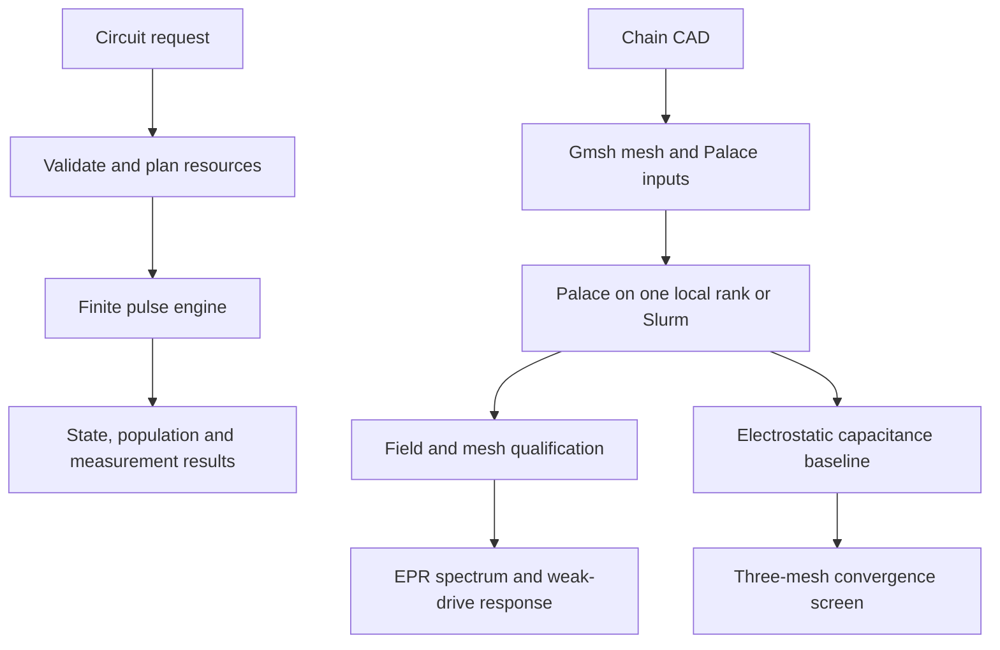

# EmulateQPU-4Q

EmulateQPU-4Q models a chain of four data transmons and three tunable couplers
with four microwave drives and a readout resonator coupled to the second
transmon. Run an assumed finite-circuit experiment locally, generate a 3D Gmsh
mesh and Palace inputs, or use solved fields to qualify a small-signal model.

The circuit example has editable parameters and runs without Palace. The
electrodynamic workflow requires a compatible Palace build for field solves
and applies mesh, mode, loss, and scattering checks before serving a reduced
model. The reduced response uses fixed idle biases and weak tones.

## Run a circuit experiment

From a source checkout, use Python 3.11 or later and install dependencies from
the lockfile. Use a fresh output directory for each run.

```sh
uv sync --locked
uv run --locked emulateqpu init --example four-qubit --output experiment
uv run --locked emulateqpu plan experiment/request.json
uv run --locked emulateqpu run experiment/request.json --output run
uv run --locked emulateqpu inspect run
```

Edit `experiment/request.json` to change the pulse amplitude, carrier frequency,
phase, or initial input. The example uses an assumed capacitance model and
idealized readout. It runs on the CPU.

## Generate field inputs

```sh
uv sync --locked --extra physical
uv run --locked --extra physical python -m emulateqpu.fullwave prepare meshes/coarse --refinement coarse
uv run --locked --extra physical python -m emulateqpu.fullwave prepare meshes/fine --refinement fine
```

The field guide covers the local solve, native overlap, qualification, and drive
response. The Slurm guide covers explicit submission and result verification
on a shared site filesystem. [Four-qubit field workflow](docs/FULLWAVE.md) ·
[Slurm field jobs](docs/HPC.md)

## Measure electrostatic mesh convergence

```sh
uv run --locked --extra physical python -m emulateqpu.fullwave.mesh_study prepare mesh-ladder --full-assembly
```

This creates three meshes with identical geometry and terminal order. Use
`mesh_study run` to solve each level with Palace and `mesh_study analyze` to
compare terminal capacitances and differential charging energies. The local
diagnostic includes the matrices and run conditions used for the comparison.
[Mesh qualification](docs/MESH_QUALIFICATION.md) ·
[Local mesh results](reproducibility/mesh-ladder/README.md)

Recalculate the published mesh differences from the saved capacitance tables.

```sh
uv run --locked --extra physical python reproducibility/mesh-ladder/replay.py
```

## Architecture



## Tests and licenses

Run `just test` for the core and field workflow tests. Run `just reference` for
independent scqubits spectra and QuTiP dynamics comparisons. The scheduler tests
use deterministic command fixtures. Use your own solver build and inputs to
establish numerical qualification.

Software is licensed under Apache-2.0. Original documentation and numerical
benchmark data are licensed under CC BY 4.0. [License](LICENSE.md) · [Notice](NOTICE) ·
[Dependency licenses](THIRD_PARTY.md) · [Contributing](CONTRIBUTING.md)
